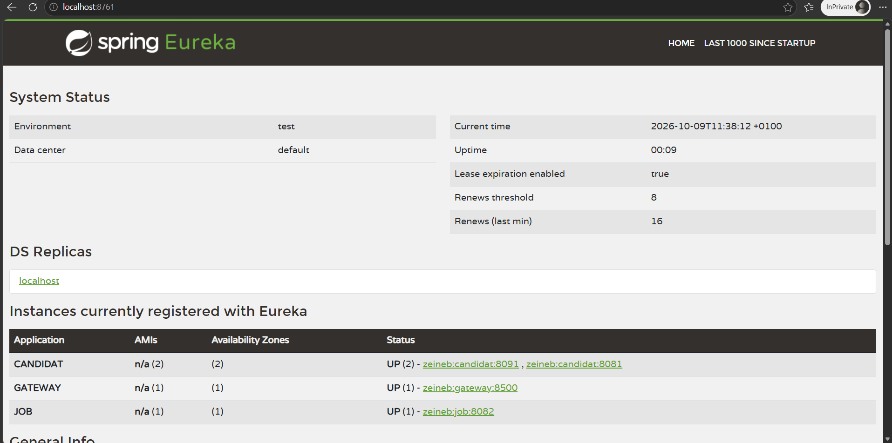
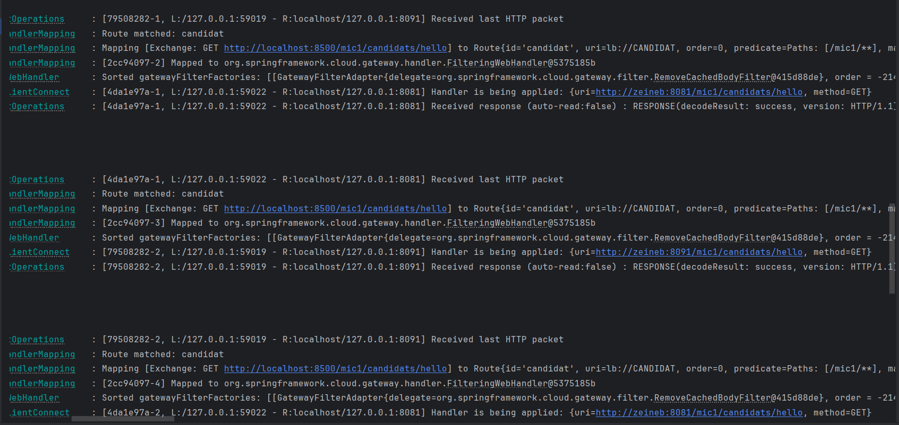

# Workshop 3 – Implémentation de l’API Gateway

🎓 **Formation : Microservices**  
📅 **Année universitaire : 2025–2026**  
🧑‍💻 **Workshop 3**

---

## 🎯 Objectif du workshop

L’objectif de ce workshop est de mettre en place une **API Gateway** jouant le rôle de point d’entrée unique vers les microservices.

À la fin de ce workshop, l’étudiant sera capable de :

- Comprendre le rôle d’une API Gateway dans une architecture microservices
- Mettre en place une configuration **statique**
- Mettre en place une configuration **dynamique avec Eureka**
- Observer le mécanisme de **load balancing**
- Comparer les approches statique et dynamique

---

## 🧩 Architecture mise en place

Dans ce workshop, nous mettons en œuvre :

- 🖥️ Un **API Gateway**
- 📦 Les microservices existants (Candidat, Job)
- 🔁 Routage des requêtes via la Gateway
- ⚖️ Load balancing automatique via Eureka

L’API Gateway agit comme un **intermédiaire intelligent** qui :

- Reçoit les requêtes clients
- Sélectionne une instance disponible
- Redirige la requête vers le microservice approprié

---

## 🛠️ Technologies utilisées

- Java 17
- Spring Boot
- Spring Cloud Gateway
- Spring Cloud Netflix Eureka Client
- Maven
- IntelliJ IDEA

---

## 📄 Énoncé du workshop

L’énoncé détaillé du Workshop 3 est disponible au format PDF :

👉 [Télécharger l’énoncé du Workshop 3](Implémentation API Gateway.pdf)

---

## 📝 Travail à faire (Rendu)

- Implémenter une **configuration statique**
- Implémenter une **configuration dynamique avec Eureka**
- Activer les logs de routage
- Identifier l’algorithme de load balancing utilisé
- Tester l’algorithme **Random** uniquement pour le service Candidat
- Comparer les deux approches (statique vs dynamique)

---

## ⚖️ Comparaison des approches

| Approche | Utilise Eureka ? | Avantages | Inconvénients |
|-----------|------------------|------------|---------------|
| Dynamique (lb://service) | ✅ Oui | Pas besoin de connaître l’URL exacte, support multi-instances, load balancing automatique | Dépendance à Eureka |
| Statique (uri http://...) | ❌ Non | Simple et rapide à configurer | Non adapté aux environnements dynamiques |

---

## ✅ Rendu attendu

- Projet **API Gateway fonctionnel**
- Routage correct vers les microservices
- Intégration réussie avec Eureka
- Load balancing observable en console
- Code structuré et propre
- Projet poussé sur **GitHub**

---

💡 **Conseil :**  
Démarrez toujours le serveur Eureka avant de lancer l’API Gateway et les microservices.

🚀 Bon courage et bonne implémentation !

---

## 🏫 Cadre pédagogique

### Enseignante : [Badia Bouhdid](https://www.linkedin.com/in/badiabouhdid)

Ce workshop a été développé dans le cadre du module **Applications Web Distribuées**,  
à l’**École d’Ingénieurs ESPRIT**.

# Workshop 3 : API Gateway

## Équipe

- Hamdi Safa
- Messaoui Malak
- Ouertani Sara
- Ouertatani Aziz
- Dridi Houssem

## Architecture

La Gateway (Spring Cloud Gateway, port 8500) est le point d'entrée unique. Elle est enregistrée dans Eureka (port 8761) et redirige les requêtes vers les microservices.

| Route | Chemin Gateway | Service | Instances |
|---|---|---|---|
| candidat | /mic1/** | CANDIDAT | 8081, 8091 |
| job | /mic2/** | JOB | 8082 |

## Partie 2 : configuration statique

Les routes pointent directement vers l'adresse du service (Eureka n'intervient pas) :

```java
.route("candidat", r -> r.path("/mic1/**").uri("http://localhost:8081"))
.route("job", r -> r.path("/mic2/**").uri("http://localhost:8082"))
```

## Partie 3 : configuration dynamique avec Eureka

Méthode 1 (classe Java) :

```java
.route("candidat", r -> r.path("/mic1/**").uri("lb://CANDIDAT"))
.route("job", r -> r.path("/mic2/**").uri("lb://JOB"))
```

Méthode 2 (application.properties) :

```
spring.cloud.gateway.routes[0].id=candidat
spring.cloud.gateway.routes[0].uri=lb://CANDIDAT
spring.cloud.gateway.routes[0].predicates[0]=Path=/mic1/**
spring.cloud.gateway.routes[1].id=job
spring.cloud.gateway.routes[1].uri=lb://JOB
spring.cloud.gateway.routes[1].predicates[0]=Path=/mic2/**
```

Les logs de routage sont activés :

```
logging.level.org.springframework.cloud.gateway=DEBUG
logging.level.reactor.netty.http.client=DEBUG
```

## Réponses aux questions

### Question 2.b : algorithme de load balancing

Avec deux instances de CANDIDAT (8081 et 8091), les logs montrent une alternance stricte (8091, 8081, 8091, 8081...). L'algorithme par défaut est donc le **Round Robin** (Spring Cloud LoadBalancer) : les requêtes sont réparties à tour de rôle entre les instances.

### Question 3 : algorithme Random pour CANDIDAT

Il existe aussi l'algorithme **Random** (instance choisie au hasard). Il est appliqué uniquement à CANDIDAT :

```java
public class RandomLoadBalancerConfig {
    @Bean
    ReactorLoadBalancer<ServiceInstance> randomLoadBalancer(Environment environment,
                                                            LoadBalancerClientFactory factory) {
        String name = environment.getProperty(LoadBalancerClientFactory.PROPERTY_NAME);
        return new RandomLoadBalancer(
                factory.getLazyProvider(name, ServiceInstanceListSupplier.class), name);
    }
}
```

```java
@LoadBalancerClient(name = "CANDIDAT", configuration = RandomLoadBalancerConfig.class)
```

La classe n'a pas `@Configuration`, sinon Random s'appliquerait à tous les services. Dans les logs, l'alternance n'est plus régulière (par exemple 8091, 8081, 8091, 8091, 8081, 8081).

## Statique vs dynamique

| Approche | Utilise Eureka ? | Avantages | Inconvénients |
|---|---|---|---|
| Statique (http://...) | Non | Simple et rapide, fonctionne sans Eureka | Une seule instance, pas de load balancing, casse si le port ou l'adresse change |
| Dynamique (lb://SERVICE) | Oui | URL inconnue à l'avance, plusieurs instances, load balancing automatique | Dépendance à Eureka, délai de découverte |

Méthode 1 (classe Java) ou Méthode 2 (application.properties) : le résultat est le même. La Méthode 1 est plus flexible (filtres, logique), la Méthode 2 est plus simple à modifier sans toucher au code.

## Lancer le projet

1. Eureka Server : http://localhost:8761
2. candidat (8081 et 8091 avec `-Dserver.port=8091`) et job (8082)
3. Gateway (8500)

Tests :

- http://localhost:8500/mic1/candidats/hello
- http://localhost:8500/mic2/job/hello

## Captures



